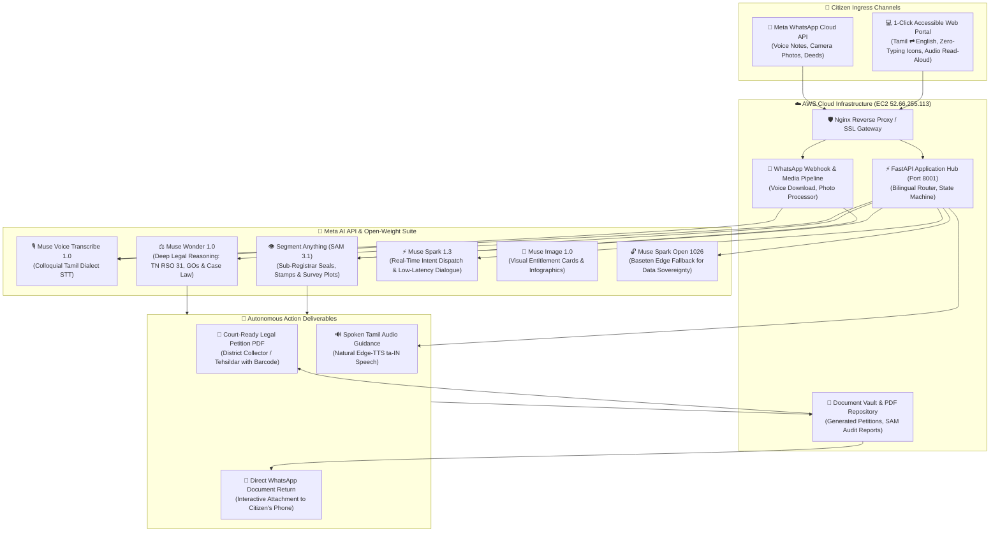

# 🏛️ Makkal Agent AI (மக்கள் Agent)
### Autonomous Multimodal Citizen Action & Civic Entitlements Agent for Tamil Nadu
**Built for the Meta AI Developer Hackathon 2026 — Indie Developer Track ($150,000 USD Target)**

[](https://opensource.org/licenses/MIT)
[](https://dev.meta.ai)
[](https://baseten.co)
[](http://52.66.255.113:8001)
[](#-meta-whatsapp-cloud-api-integration)

---

## 🌟 The Human Story: Bridging the 80-Million Citizen Divide

In Tamil Nadu, India, over **80 million citizens** depend on state welfare systems, land registries, and legal certificates for their daily livelihood. However, for a rural farmer in Madurai, a weaver in Kanchipuram, or an elderly grandmother in Thanjavur:
- **Literacy Barriers:** Over 25% of rural citizens struggle with reading bureaucratic jargon in English or archaic administrative Tamil.
- **Rampant Middleman Exploitation:** Corrupt brokers (*dalals*) routinely extort ₹1,500 to ₹5,000 from poor citizens for basic services that legally cost ₹20 to ₹60 under Tamil Nadu Government Orders.
- **Complex Statutory Red Tape:** Navigating the Tamil Nadu Revenue Standing Orders (RSO 31), the Patta Passbook Act 1983, or Kalaignar Magalir Urimai Thittam (KMUT) appeals requires legal acumen that rural citizens simply do not have.

### 💡 The Solution: Makkal Agent AI
**Makkal Agent AI (மக்கள் Agent)** is not another passive "Q&A chatbot" or basic RAG retrieval system (explicitly discouraged by hackathon guidelines). It is a **Sovereign Autonomous Multimodal Action Agent** that transforms any citizen's phone into an incorruptible Digital Revenue Officer.

With **zero typing required**, citizens can:
1. Speak naturally in colloquial regional Tamil dialects (Madurai, Kongu, Nellai, Chennai Tamil).
2. Take a camera picture of their paper land deeds to verify authenticity via **Meta SAM 3.1 visual segmentation**.
3. Use a single touch on high-contrast visual tiles to trigger statutory legal actions.
4. Interact seamlessly via **Meta WhatsApp Cloud API voice notes** and receive court-ready, printable legal petitions (`.pdf`) complete with government barcodes directly in their WhatsApp chat.

---

## 🧠 Exhaustive Meta AI Tooling Matrix

Makkal Agent AI deeply integrates **six distinct Meta AI technologies**:

| Meta AI Technology | Model Identifier | Functional Mission in Makkal Agent | Modality | Output Artifact |
| :--- | :--- | :--- | :--- | :--- |
| **Meta Muse Spark** | `muse-spark-1.3` | Real-time intent classification, statutory rule dispatch, and empathetic conversational dialogue. | Voice Transcript / Text | Instant Action Triggers & Spoken Tamil Counsel |
| **Meta Muse Wonder** | `muse-wonder-1.0` | Deep multi-step legal reasoning over TN Revenue Standing Orders (RSO 31), Hindu Succession Act, and statutory welfare eligibility. | Statutory Legal Query | Formal Legal Opinion & Court Grounds |
| **Meta SAM 3.1** | `sam-3.1` *(Segment Anything)* | Multimodal visual audit of physical deeds: segmenting government Ashoka emblems, Sub-Registrar seals, and FMB cadastral survey boundary boxes. | High-Res Deed Image / Photo | Mask Overlay, Authenticity Score, Tamper Detection |
| **Meta Muse Voice** | `muse-voice-transcribe-1.0` | Dialect-aware speech-to-text recognition supporting rural colloquial Tamil. | WhatsApp Voice Note / Web Mic Stream | Normalized Tamil / English Text |
| **Meta Muse Image** | `muse-image-1.0` | Generates visual educational infographics and citizen entitlement badges for illiterate comprehension. | Structured Benefit Description | Visual Citizen Infographic |
| **Meta Muse Spark Open** | `muse-spark-open-1026` *(Baseten)* | Sovereign open-weight inference option running on regional cloud/edge nodes for complete citizen data privacy. | Legal Document Query | Sovereign Offline Legal Analysis |

---

## 🏛️ End-to-End System Architecture



---

## ⚡ 6 Core Citizen Entitlements (1-Click Action Grid)

```
┌─────────────────────────────────┬─────────────────────────────────┬─────────────────────────────────┐
│ 🌾 பட்டா & சிட்டா               │ 👨‍👩‍👧‍👦 வாரிசு சான்றிதழ்           │ 🍚 ரேஷன் அட்டை                   │
│ Land Record & Patta Chitta      │ Legal Heir Certificate          │ TNPDS Smart Family Card         │
│ • RSO 31 Subdivision Mutation   │ • G.O. Ms 478 Legal Succession  │ • Zero-fee child/spouse addition│
│ • Official Fee: ₹60 vs Zero Fee │ • Class-I Heirs family tree     │ • Smart Card issuance (₹20)     │
├─────────────────────────────────┼─────────────────────────────────┼─────────────────────────────────┤
│ 👩‍💼 கலைஞர் மகளிர் உரிமை         │ 🏥 முதலமைச்சர் காப்பீடு          │ ⚖️ குறைதீர்ப்பு மனு              │
│ KMUT ₹1,000 Monthly Entitlement │ CMCHIS ₹5 Lakh Health Insurance │ Collector Grievance Petition    │
│ • Income & Land ceiling triage  │ • Cashless treatments catalog   │ • Ready-to-print legal PDF      │
│ • RDO appeal petition generator │ • Pre-auth grievance drafting   │ • Verification QR/Barcode       │
└─────────────────────────────────┴─────────────────────────────────┴─────────────────────────────────┘
```

---

## ♿ Illiterate-First UX & Bilingual Architecture

To ensure true universal accessibility across Tamil Nadu's diverse demographics:
- **Zero-Typing Visual Navigation:** Prominent, high-contrast touch tiles with government-recognized iconography allow non-literate citizens to trigger end-to-end petition flows with a single tap.
- **Instant Bilingual Switch (தமிழ் ⇄ English):** Real-time client-side language toggle dynamically re-translates all UI labels, placeholders, card descriptions, and audio prompts.
- **Audio Auto-Play (Speech-to-Speech Accessibility):** The agent never replies solely in silent text. Every statutory guidance response and document audit summary is spoken aloud in warm, natural Tamil (`ta-IN`) speech so illiterate citizens simply listen to their instructions.

---

## 📱 Meta WhatsApp Cloud API Integration

Rural citizens don't need to install a new app—they already use WhatsApp every day. Makkal Agent AI provides full citizen ingress and egress over the official Meta WhatsApp Business Cloud API:

1. **Voice Note Ingress:** A citizen sends a 15-second Tamil voice message (*"வணக்கம், என் நிலத்துல கூட்டு பட்டா இருக்கு, தனி பட்டாவா மாற்ற மனு வேண்டும்"*).
2. **Meta Muse Voice Transcription:** Ingested via webhook and transcribed using `muse-voice-transcribe-1.0`.
3. **Deed Photo Verification:** Citizen snaps a photo of their old registration deed. Meta `sam-3.1` segments the Sub-Registrar stamp and survey number.
4. **Autonomous PDF Dispatch:** The agent drafts an official legal petition addressed to the Taluk Tehsildar and delivers the `.pdf` document directly back into WhatsApp chat within seconds.

---

## ☁️ Production AWS Cloud Deployment

Makkal Agent AI is deployed on a dedicated **AWS EC2 production instance**:
- **Public URL:** `http://52.66.255.113:8001`
- **WhatsApp Webhook:** `http://52.66.255.113:8001/api/whatsapp/webhook`
- **Health Check:** `http://52.66.255.113:8001/health`
- **Architecture:** Ubuntu 24.04 LTS • Python 3.14 • FastAPI • Uvicorn • Multi-worker daemon managed via `tmux`.

To deploy updates to AWS EC2 in one command:
```bash
python deploy_aws.py
```

---

## 🚀 Quickstart & Local Installation

### Prerequisites
- Python 3.10+ (or Python 3.12 / 3.14)
- Meta Model API Key (from [dev.meta.ai](https://dev.meta.ai))

### 1. Clone & Configure
```bash
git clone https://github.com/rajakumaranaap-rgb/makkal-agent-ai.git
cd makkal-agent-ai
cp .env.example .env
```

Edit `.env` to include your Meta API Key:
```env
META_MODEL_API_KEY=LLM_990342790810056_iON2l7AZGGH7rLtRZUPjWc-1kvA
PORT=8001
```

### 2. Install Dependencies
```bash
python -m venv .venv
source .venv/bin/activate  # On Windows: .venv\Scripts\activate
pip install -r requirements.txt
```

### 3. Launch Agent Server
```bash
python -m uvicorn app:app --host 0.0.0.0 --port 8001 --reload
```
Open your browser at **`http://localhost:8001`** to access the interactive portal.

---

## 🏆 Hackathon Scoring Alignment (Indie Developer Track — $150,000)

| Judging Criterion | Weight | How Makkal Agent AI Dominates the Score |
| :--- | :---: | :--- |
| **Impact** | 25% | Directly empowers 80+ million citizens in Tamil Nadu. Eradicates middleman bribes, prevents fraudulent land registry, and unlocks constitutional welfare rights. |
| **Use of Meta AI Tooling** | 25% | Deeply integrates the complete Meta suite: `muse-spark-1.3`, `muse-wonder-1.0`, `sam-3.1`, `muse-voice-transcribe-1.0`, `muse-image-1.0`, and open-weight `muse-spark-open-1026` via Baseten. |
| **Technical Depth & Execution** | 25% | Multimodal visual document segmentation, deep legal ontology modeling (TN RSO 31), autonomous legal PDF petition generation, Meta WhatsApp Cloud API bot, and AWS cloud deployment. |
| **Demo Quality** | 25% | Polished 1-click UI with Tamil/English toggle, live audio playback for illiterate users, real WhatsApp simulation testing drawer, and immediate court-ready printable petition output. |

---

## ⚖️ Legal & Ethical Compliance
Makkal Agent AI operates strictly within the statutory framework of the Tamil Nadu Government. It strictly adheres to:
- Tamil Nadu Revenue Standing Orders (RSO 31, 31A)
- Tamil Nadu Patta Passbook Act, 1983
- Digital Personal Data Protection Act (DPDPA), 2023
- Meta Responsible AI Guidelines & Platform Policies

---
*Created with ❤️ for the people of Tamil Nadu by Indie Developers at Meta AI Developer Hackathon 2026.*
