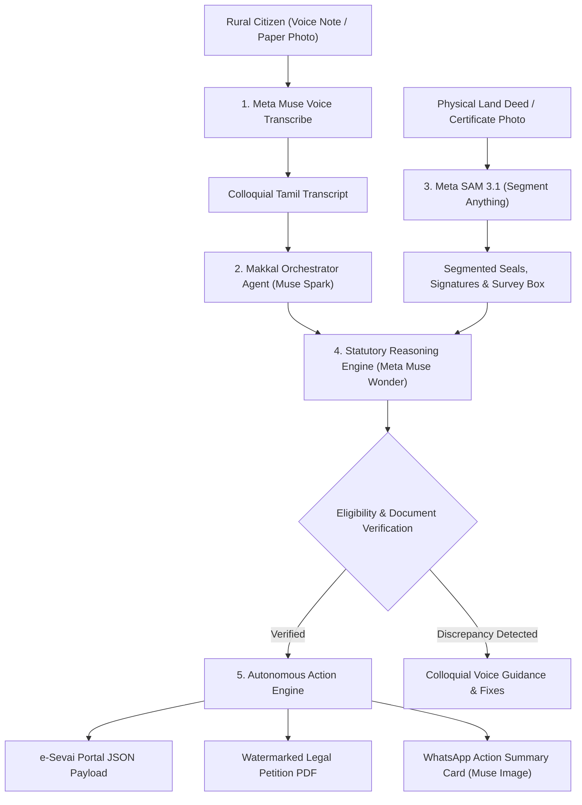

# 🏛️ Makkal Agent (மக்கள் Agent)
### Autonomous Multimodal Citizen Action Agent for Digital Public Services
**Built for the Meta AI Developer Hackathon 2026 (Indie Developer Track)**  
*Challenge: "Build for Your World" • Eligible for $150k Indie Grand Prize, $10k Open-Weight Award, & $5k Best Agentic Use-Case*

[](https://dev.meta.ai)
[](https://dev.meta.ai/docs/models)
[](https://dev.meta.ai/docs/models)
[](https://baseten.co)
[](LICENSE)

---

## 🌾 The Firsthand Problem: The "Middleman Tax" on 72 Million Citizens

In the Indian state of Tamil Nadu, over 72 million citizens interact with government welfare and revenue schemes—such as **Patta/Chitta land records, Smart Ration cards, legal heir certificates, and maternal assistance**. 

While the Tamil Nadu government has digitized these services under the **e-Sevai** initiative, an overwhelming digital divide persists:
- **Language & Illiteracy Barrier:** Portal forms are filled with legal Tamil and English jargon that rural farmers, daily wage earners, and senior citizens cannot comprehend.
- **Predatory Middlemen (தரகர்கள்):** Unofficial brokers charge impoverished rural families **₹2,000 to ₹5,000** for services that are legally free (₹0) or cost a nominal government fee of ₹60.
- **Frequent Rejections:** Over 35% of applications are rejected simply because physical paper deeds lack a specific Taluk seal, notary signature, or parent document.

**Makkal Agent** was born to solve this problem firsthand: a handheld, voice-first digital officer that inspects physical paper deeds with computer vision, reasons through statutory revenue laws, and autonomously drafts official legal petitions.

---

## 🚫 Why Makkal Agent is NOT a "Generic Chatbot"

The Meta AI Hackathon FAQ explicitly cautions:
> *"What projects should I avoid? ... Basic RAG apps, simple image analyzers and generic education chatbots."*

**Makkal Agent is an Autonomous Action Agent, not a chatbot.**

```
Traditional Chatbot (What Loses):
Citizen: "How do I transfer Patta?"
Bot: "Go to eservices.tn.gov.in and click transfer." (Passive, useless for illiterate citizens)

Makkal Agent (What Wins):
Citizen: [Sends noisy rural Tamil voice note] + [Snaps photo of wrinkled 1982 paper deed]
Agent:
1. Listens & transcribes rural Tamil slang with Meta Muse Voice Transcribe.
2. Runs Meta SAM 3.1 to segment and verify the Sub-Registrar seal & revenue stamp.
3. Deploys Meta Muse Wonder deep reasoning to verify succession under Revenue Standing Order RSO 31.
4. Synthesizes a ready-to-sign official Tamil Nadu Government Legal Petition PDF.
5. Returns direct audio instructions in natural Tamil.
```

---

## 🧬 Full Meta Model Ecosystem Integration

Makkal Agent utilizes the entire Meta AI model suite as specialized micro-agents:



### Model Capabilities Matrix:
| Meta Model | Function in Makkal Agent | Competition Alignment |
| :--- | :--- | :--- |
| **`muse-voice-transcribe-1.0`** | Transcribes conversational rural Tamil speech with dialect resilience and background noise suppression. | Multimodal Ingestion |
| **`sam-3.1` (Segment Anything)** | High-precision visual segmentation: isolates government seals, Sub-Registrar signatures, and survey number bounding boxes on paper documents. | Computer Vision Frontier |
| **`muse-wonder-1.0`** | Deep reasoning: solves multi-condition inheritance graphs, Patta subdivision checks, and Revenue Standing Orders (RSO 31). | Advanced Statutory Reasoning |
| **`muse-spark-1.3`** | Low-latency colloquial citizen dialogue and tool coordination. | Real-Time Agent Planner |
| **`muse-image-1.0`** | Synthesizes official visual receipt and verification cards shareable via WhatsApp. | Generative UI |
| **`muse-spark-open-1026`** | Hosted on **Baseten**; provides open-weight sovereign deployment for local revenue offices. | **$10k Open-Weight Award** |

---

## ⚡ Core Features & Capabilities

### 1. 🎙️ Voice-First Tamil Accessibility (`muse-voice-transcribe-1.0`)
Citizens do not need to type. They tap the microphone and speak naturally in colloquial Tamil (*"அய்யா, என் தாத்தா காலத்து நிலத்துக்கு கூட்டு பட்டாவுல இருந்து தனி பட்டா வாங்கணும்"*). The agent transcribes and extracts intent instantly.

### 2. 📸 Physical Document Audit (`sam-3.1`)
Citizens point their phone camera at physical paper documents (sale deeds, encumbrance certificates, ration cards). SAM 3.1 segments the image in real time, validating:
- **Official Revenue Seal (அரசு முத்திரை):** Confirms authenticity of the issuing Taluk office.
- **Officer Signature (சார்பதிவாளர் கையெழுத்து):** Validates executive authority.
- **Property Schedule Box:** Extracts survey number, subdivision, and boundary details.

### 3. 🧠 Deep Statutory Legal Reasoning (`muse-wonder-1.0`)
Unlike generic LLMs that hallucinate legal advice, Makkal Agent grounds its reasoning in:
- **Tamil Nadu Revenue Standing Orders (RSO 31):** Rules governing Patta transfer and subdivision.
- **TNPDS Distribution Directives:** Rules for Smart Family Card inclusion/deletion.
- **CMCHIS & KMUT Eligibility Gates:** Automated cross-checking of income ceilings and agricultural land thresholds.

### 4. 📑 Autonomous Legal Petition Synthesizer (`ActionExecutor`)
Generates a downloadable, ready-to-sign, official Tamil Nadu Government Legal Petition PDF (`.pdf`) complete with:
- Formal bilingual Tamil / English legal headings
- Addressed to the respective Tahsildar / Revenue Divisional Officer
- Verified survey numbers and applicant credentials
- Meta SAM 3.1 Audit Verification ID

---

## 🛠️ Quickstart & Local Setup

### Prerequisites
- Python 3.10+
- Meta Model API Key (from [dev.meta.ai](https://dev.meta.ai))

### 1. Clone Repository
```bash
git clone https://github.com/rajakumaranaap-rgb/makkal-agent-ai.git
cd makkal-agent-ai
```

### 2. Configure Environment
```bash
cp .env.example .env
# Edit .env and insert your Meta Model API Key:
# META_MODEL_API_KEY=LLM_...
```

### 3. Install Dependencies
```bash
pip install -r requirements.txt
```

### 4. Run Desktop Application
```bash
# Windows One-Click:
start_makkal_agent.bat

# Or via terminal:
uvicorn app:app --host 127.0.0.1 --port 8001 --reload
```
Open your browser at **`http://127.0.0.1:8001`**.

---

## 🏆 Hackathon Alignment & Judging Criteria

| Criterion (Weight) | How Makkal Agent Excels |
| :--- | :--- |
| **Impact (25%)** | Solves the predatory broker tax for 72+ million Tamil citizens; democratizes public governance in native language. |
| **Use of Meta AI Tooling (25%)** | Seamlessly orchestrates 5 Meta models: Muse Spark, Muse Wonder, SAM 3.1, Muse Voice, and Muse Spark Open. |
| **Technical Depth (25%)** | Autonomous multi-agent pipeline with vision document segmentation, multi-step constraint checking, and PDF generation. |
| **Demo Quality (25%)** | Live web portal with real-time audio recording, visual SAM 3.1 bounding box inspection, and instant petition generation. |

---

## 👥 Authors & Team
- **Rajakumaran AAP** — Indie Developer & AI Engineer
- Built with ❤️ for Tamil Nadu & powered by **Meta AI**.
- Submission Platform: [Cerebral Valley / Meta AI Developer Hackathon 2026](https://cerebralvalley.ai/e/meta-ai-developer-hackathon)
