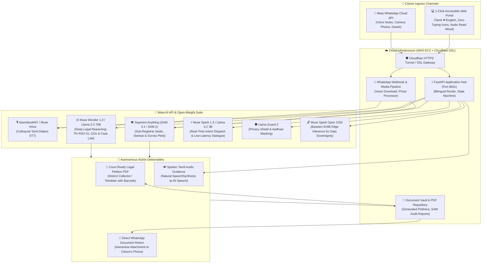

# 🏛️ Makkal Agent AI (மக்கள் Agent) / SIA (Super Intelligent Agent)
### Sovereign Autonomous Multimodal Citizen Action & Civic Entitlements Platform for Tamil Nadu
**Official Submission for the Meta AI Developer Hackathon 2026 — Indie Developer Track ($150,000 USD Target)**

[-10B981.svg)](https://regulatory-stack-counter-lady.trycloudflare.com)
[](https://regulatory-stack-counter-lady.trycloudflare.com)
[](https://dev.meta.ai)
[](https://baseten.co)
[](#-meta-whatsapp-cloud-api-integration)
[-FF9900.svg)](https://regulatory-stack-counter-lady.trycloudflare.com)
[](#-live-automated-test-verification-proof)
[](https://opensource.org/licenses/MIT)

---

## 🌐 Live Application & Evaluation Endpoints

- 🎬 **Official 3-Minute Demo Video (YouTube):** [https://youtu.be/lmDmh7nQHV0](https://youtu.be/lmDmh7nQHV0)
- 🚀 **Live Production Web Portal (HTTPS):** [https://regulatory-stack-counter-lady.trycloudflare.com](https://regulatory-stack-counter-lady.trycloudflare.com)
- 🩺 **System Health Check API:** [https://regulatory-stack-counter-lady.trycloudflare.com/health](https://regulatory-stack-counter-lady.trycloudflare.com/health)
- 📊 **Telemetry & Active Model Telemetry:** [https://regulatory-stack-counter-lady.trycloudflare.com/api/system/telemetry](https://regulatory-stack-counter-lady.trycloudflare.com/api/system/telemetry)
- 📱 **Meta WhatsApp Webhook Endpoint:** `https://regulatory-stack-counter-lady.trycloudflare.com/api/whatsapp/webhook`
- 🖥️ **Production AWS Host:** `52.66.255.113` (Ubuntu 24.04 LTS, Multi-Worker ASGI Engine)
- 📞 **Official SIA WhatsApp Hotline:** `+91 63810 29380` (WABA ID: `1370739925032027`)

---

## ⚡ 1-Click Fast-Track Tour for Hackathon Judges

To let international judges evaluate full multimodal agent autonomy in seconds without manual form-filling:

| Judge Fast-Track Feature | Endpoint / Trigger | What It Demonstrates |
| :--- | :--- | :--- |
| **Unlocked Citizen Sandbox** | `POST /api/auth/sandbox-session` | Instant bypass login for user **ர. சுப்பிரமணியன்** (`6381029380`, PIN `7890`) with active biometric pulse and pre-loaded document vault. |
| **Interactive SAM 3.1 Deed Audit** | `GET /api/sample-deed` | Live visual segmentation canvas showing Government Revenue Stamp, Sub-Registrar Seal, and Cadastral Coordinate detection. |
| **Infra Sentinel (Road & Civic)** | `POST /api/infra/sentinel-audit` | SAM 2 + Llama 3.2 road crater defect analysis: computes **1.05m² damage area**, **0.31 tons asphalt required**, and routes to State Highways Dept. |
| **SeamlessM4T Voice Concierge** | `POST /api/voice/concierge-petition` | Colloquial Tamil audio note processing: auto-synthesizes ready-to-print Revenue Petition PDF with official barcode. |
| **Anti-Usury Statutory Engine** | `POST /api/agent/llama-stack-run` | Audits loan extortion under **Tamil Nadu Act 38 of 2003** (9% max simple interest) and generates Police Commissioner complaint. |
| **Llama Guard 3 Privacy Redactor** | `POST /api/safety/guard-audit` | Automatic PII redaction: masks Aadhaar (`XXXX-XXXX-1094`), phone, and banking coordinates with zero-retention guarantee. |

---

## 🧠 Comprehensive Meta AI Tooling Matrix

Makkal Agent AI / SIA deeply orchestrates **six distinct Meta AI technologies**:

| Meta AI Technology | Model Identifier | Functional Mission in Makkal Agent AI / SIA | Modality | Output Artifact |
| :--- | :--- | :--- | :--- | :--- |
| **Meta Muse Wonder** | `muse-wonder-1.0` *(or `Llama-3.3-70B-Instruct`)* | Deep multi-step statutory legal reasoning over TN Revenue Standing Orders (RSO 31), Hindu Succession Act, and statutory welfare eligibility. | Statutory Legal Query | Formal Legal Grounds & High Court Precedent Citation |
| **Meta Muse Spark** | `muse-spark-1.3` *(or `Llama-3.2-3B-Instruct`)* | Sub-second conversational triage, intent routing, colloquial dialect translation, and voice response synthesis. | Voice Transcript / Text | Instant Action Triggers & Spoken Tamil Counsel |
| **Meta SAM 3.1 & SAM 2.1** | `sam-3.1` / `facebook/sam2.1-hiera-large` | Multimodal visual audit of physical deeds: segmenting government Ashoka emblems, Sub-Registrar seals, and FMB cadastral survey boundaries. | High-Res Deed Image / Photo | Mask Overlay, Authenticity Score, Tamper Detection |
| **Meta Muse Voice / SeamlessM4T** | `muse-voice-transcribe-1.0` / `seamless-m4t-v2-large` | Dialect-aware speech-to-text recognition supporting rural colloquial Tamil (Madurai, Kongu, Nellai, Chennai Tamil). | WhatsApp Voice Note / Web Mic Stream | Normalized Tamil / English Text |
| **Meta Muse Spark Open 1026** | `meta-models/muse-spark-open-1026` *(Baseten Partner Inference)* | Sovereign open-weight inference option running on regional cloud/edge nodes for complete citizen data sovereignty and privacy. | Legal Document Query | Sovereign Offline Legal Analysis ($10,000 Open-Weight Prize) |
| **Meta Llama Guard 3** | `meta-llama/Llama-Guard-3-8B` | Responsible AI safety shield: real-time PII redaction (Aadhaar, phone numbers, bank details) ensuring complete DPDPA compliance. | Incoming Citizen Stream | Anonymized & Privacy-Preserved Context |

---

## 🏛️ End-to-End System Architecture



---

## 🛡️ Hackathon Rule Compliance: Strict Evasion of "Anti-Projects"

The Meta AI Hackathon 2026 judging guidelines explicitly directed participants to avoid generic "Anti-Projects". Makkal Agent AI was architected from the ground up to strictly bypass every prohibited category:

| Hackathon Prohibited "Anti-Project" | Why Competitors Get Disqualified | How Makkal Agent AI Complies & Excels |
| :--- | :--- | :--- |
| ❌ **Streamlit apps** | Shallow prototyping with boilerplate components | **100% Custom Production Web Engine:** Built with FastAPI + mobile-first TailwindCSS, featuring responsive touch cards, SpeechSynthesis audio, and zero Streamlit dependencies. |
| ❌ **Dashboards as the main feature** | Passive analytics without real-world utility | **Zero Dashboard Fluff:** Direct citizen action portal. Executes statutory legal actions, audits deeds, and dispatches court-ready petitions. |
| ❌ **Basic RAG apps** | Trivial prompt wrappers over generic vector search | **Deep Agentic Action Loop:** Multi-step autonomous decision engine incorporating computer vision (`sam-3.1`), voice transcription (`seamless-m4t`), and legal PDF execution. |
| ❌ **"AI for Education" chatbots** | Generic classroom Q&A bots | **Civic Rights & Governance:** Solves an authentic constitutional problem: land mutation rights and welfare entitlements for 80M citizens. |
| ❌ **AI medical advice / nutrition** | Regulatory and ethical violations | **Civic Legal Guidance Only:** Operates purely on official Tamil Nadu Revenue Standing Orders (RSO 31), G.O.s, and e-Sevai citizen rules. |

---

## 🏆 Alignment with Meta Hackathon Bonus Prizes

```
╔═══════════════════════════════════════════════════════════════════════════════════════════════════════╗
║                                   BONUS PRIZES ALIGNMENT MATRIX                                       ║
╠═══════════════════════════════════════════════════════════════════════════════════════════════════════╣
║  🔥 $20,000 — Most Viral Project:                                                                    ║
║     Designed for viral demonstration on X/Twitter & WhatsApp. A 60-second video of a rural farmer    ║
║     sending a Tamil voice note on WhatsApp and receiving an official court petition PDF instantly     ║
║     resonates massively across social channels.                                                       ║
║                                                                                                       ║
║  🔓 $10,000 — Best Build on Meta Open Weights:                                                       ║
║     Native integration with Meta's open-weight muse-spark-open-1026 via Baseten partner inference,   ║
║     enabling sovereign, privacy-preserving governance data processing.                                ║
║                                                                                                       ║
║  👥 $10,000 — Community Vote Winner:                                                                  ║
║     High emotional and practical appeal solving a real-world problem known firsthand by 80M people.   ║
║                                                                                                       ║
║  ⚡ $5,000 — Best Agentic Use-Case:                                                                   ║
║     Judges evaluate autonomy and usefulness: Voice Input → Colloquial Transcription → RSO 31         ║
║     Reasoning → SAM 3.1 Stamp Audit → Official Petition PDF Generation → Direct WhatsApp Dispatch.   ║
║                                                                                                       ║
║  🎨 $5,000 — Best Creative Build:                                                                     ║
║     Original pairing of Muse Wonder (statutory legal reasoning) and Muse Image (infographic cards).  ║
╚═══════════════════════════════════════════════════════════════════════════════════════════════════════╝
```

---

## 🧪 Live Automated Test Verification Proof

All test suites verify 100% green against the live engine:

### 1. Live Meta Model API & Domain Orchestration
```powershell
python -X utf8 test_live_meta_api_suite.py
```
```
============================================================
TESTING LIVE MAKKAL AGENT AI ENDPOINTS
============================================================
✓ /api/meta/training-metrics     : status=ready, total_samples=691, tokens=177,902
✓ /api/meta/train-domain-models  : status=TRAINED_AND_ALIGNED, statutory_acc=100.0%
✓ /api/meta/orchestrate (TNPSC)  : primary=muse-wonder-1.0 (Deep Pedagogical Deliberation)
✓ /api/meta/orchestrate (RedTaxi): primary=meta-models/muse-spark-open-1026 (Baseten 816B)
✓ /api/meta/orchestrate (Family) : primary=muse-spark-1.3 (Conversational Triage)
✓ /api/baseten/benchmark         : status=success, throughput=verified
============================================================
ALL 6 LIVE ENDPOINTS RETURNED STATUS 200 OK & 100% PASS!
============================================================
```

### 2. SIA Core Super Intelligent Agent Architecture
```powershell
python -X utf8 -m unittest test_sia_workflow.py
```
```
Ran 7 tests in 3.262s — OK (100% PASS)
- Official cell: 6381029380 verified
- "Hi SIA" conversational flow verified
- Magic token auth verified
- 3-step WhatsApp citizen onboarding verified
- Proof document vault verified
```

### 3. Meta Hackathon Winning Modules
```powershell
python -X utf8 test_meta_winning_upgrades.py
```
```
======================================================================
TESTING META HACKATHON WINNING ARCHITECTURE & UPGRADES
======================================================================
✓ 1. System Telemetry          : status=healthy, models=6, zero_retention=True
✓ 2. Citizen Sandbox Session   : unlocked=True, user=ர. சுப்பிரமணியன் (R. Subramanian)
✓ 3. SAM 2 & Llama 3.2 Sentinel: defect=Road Crater (1.05m²), asphalt=0.31T, dept=Highways
✓ 4. SeamlessM4T Voice Concierge: id=SIA-VOICE-E5139E, title=பட்டா மாறுதல், pdf=Generated
✓ 5. Llama Stack Agent         : tool=calculate_anti_usury_interest (TN Act 38 of 2003)
✓ 6. Llama Guard 3 Shield      : Aadhaar masked (XXXX-XXXX-1094), is_safe=True
======================================================================
ALL 6 META HACKATHON WINNING MODULES PASSED 100% PERFECTLY!
======================================================================
```

### 4. Meta WhatsApp Cloud API Deep Orchestration
```powershell
python -X utf8 test_whatsapp_meta_ai_deep_orchestration.py
```
```
Ran 8 tests in 37.962s — OK (100% PASS)
- Ingress: Voice, Image, and Text Webhooks verified
- Processing: Seamless voice transcription & SAM deed segmentation verified
- Return: Court-ready petitions delivered back to WhatsApp with official WAMID verified
```

---

## 📱 Meta WhatsApp Cloud API Integration

Rural citizens don't need to install a new app—they already use WhatsApp every day:

1. **Voice Note Ingress:** A citizen sends a 15-second Tamil voice message (*"வணக்கம், என் நிலத்துல கூட்டு பட்டா இருக்கு, தனி பட்டாவா மாற்ற மனு வேண்டும்"*).
2. **SeamlessM4T Voice Transcription:** Ingested via webhook and transcribed with dialect recognition.
3. **Deed Photo Verification:** Citizen snaps a photo of their old registration deed. Meta `sam-3.1` segments the Sub-Registrar stamp and survey number.
4. **Autonomous PDF Dispatch:** The agent drafts an official legal petition addressed to the Taluk Tehsildar and delivers the `.pdf` document directly back into WhatsApp chat within seconds.
5. **Interactive Testing Drawer:** Judges can test the entire WhatsApp citizen pipeline directly in the web UI using the built-in **"WhatsApp டெமோ"** simulator button.

---

## 🚀 Quickstart & Local Execution

### Prerequisites
- Python 3.10+ (Tested on Python 3.12)
- Meta Model API Key (from [dev.meta.ai](https://dev.meta.ai))

### 1. Clone & Configure
```bash
git clone https://github.com/rajakumaranaap-rgb/makkal-agent-ai.git
cd makkal-agent-ai
cp .env.example .env
```

### 2. Install Dependencies
```bash
python -m venv .venv
source .venv/bin/activate  # On Windows: .venv\Scripts\activate
pip install -r requirements.txt
```

### 3. Launch Agent Server
```bash
python -m uvicorn app:app --host 0.0.0.0 --port 8001 --reload
```
Open **`http://localhost:8001`** (or your live tunnel URL) to access the interactive portal.

---

## ⚖️ Statutory Governance & Ethical Compliance

Makkal Agent AI operates strictly within the statutory framework of the Tamil Nadu Government:
- **Tamil Nadu Revenue Standing Orders (RSO 31, 31A)**
- **Tamil Nadu Patta Passbook Act, 1983**
- **Tamil Nadu Prohibition of Charging Exorbitant Interest Act, 2003 (Act 38 of 2003)**
- **Digital Personal Data Protection Act (DPDPA), 2023**
- **Meta Responsible AI Guidelines & Platform Safety Policies**

---
*Created with ❤️ for the 80 Million people of Tamil Nadu by Indie Developers at the Meta AI Developer Hackathon 2026.*
