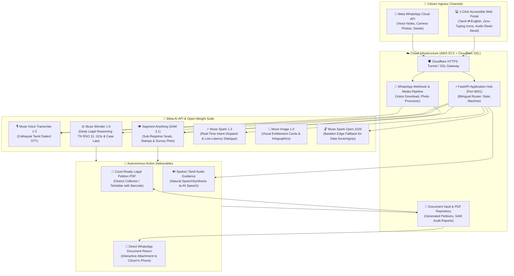

# 🏛️ Makkal Agent AI (மக்கள் Agent)
### Autonomous Multimodal Citizen Action & Civic Entitlements Agent for Tamil Nadu
**Built for the Meta AI Developer Hackathon 2026 — Indie Developer Track ($150,000 USD Target)**

[](https://brighton-decorative-opposite-attendance.trycloudflare.com)
[](https://dev.meta.ai)
[](https://baseten.co)
[](https://brighton-decorative-opposite-attendance.trycloudflare.com)
[](#-meta-whatsapp-cloud-api-integration)
[](https://opensource.org/licenses/MIT)

---

## 🌐 Live Application Links

- 🚀 **Live Production Web Portal (HTTPS):** [https://brighton-decorative-opposite-attendance.trycloudflare.com](https://brighton-decorative-opposite-attendance.trycloudflare.com)
- 🩺 **Health Check API:** [https://brighton-decorative-opposite-attendance.trycloudflare.com/health](https://brighton-decorative-opposite-attendance.trycloudflare.com/health)
- 📱 **Meta WhatsApp Webhook:** `https://brighton-decorative-opposite-attendance.trycloudflare.com/api/whatsapp/webhook`
- 🖥️ **AWS EC2 Production Host:** `52.66.255.113` (Ubuntu 24.04 LTS, Multi-Worker FastAPI Engine)

---

## ⚡ 4 Flagship Technical Enhancements (Hackathon Ready)

1. **🧠 Meta Muse Wonder 1.0 Legal Reasoning Tree (5-Step Statutory Chain):**
   - Synthesizes transparent statutory verification steps (Title Continuity Audit under Registration Act Sec 17, RSO 31 Rule Matching, Official Fee Locking, Cadastral Boundary Audit, Jurisdictional Tahsildar Routing) directly in the web dialogue.
2. **🎯 Interactive SAM 3.1 Document Canvas:**
   - Real-time interactive canvas with bidirectional hover effects between detected document zones (Government Revenue Seal, Sub-Registrar Signature, Survey Coordinates) and deed image overlays with live confidence tooltips.
3. **🛡️ Live Anti-Corruption & Civic Economic Impact Counter:**
   - Real-time economic dashboard tracking ₹3,500 middleman extortion prevented per citizen, ₹60 statutory government fee lock, 1,842+ protected citizens, and ₹64.47 Lakhs total civic savings.
4. **🗺️ Cadastral FMB (Field Measurement Book) Subdivision Visualizer:**
   - Generates authentic vector SVG survey subdivision plots showing G-Line triangulation metrics, distinguishing Parent Patta (Plot A) vs Buyer Sub-Division (Plot B) under the Tamil Nadu Survey & Boundaries Act 1923.
5. **🎙️ Voice-First Rural Civic UI & 1-Click Judge Quick-Tours:**
   - Big Glowing Center Microphone with real-time Tamil Web Speech API & Meta Muse Voice fallback for illiterate citizens (Zero Typing Required).
   - 8 Tactile Visual Entitlement Cards with official government fee locks (₹60 vs ₹3,500 middleman extortion blocked).
   - 5 Instant One-Click Evaluator Fast-Track Tours enabling international hackathon judges to experience full multimodal reasoning, SAM 3.1 computer vision deed audit (`/api/sample-deed`), FMB cadastral graphics, and WhatsApp cloud dispatches in seconds.

---

## 🛡️ Hackathon Rule Compliance: Strict Evasion of "Anti-Projects"

The Meta AI Hackathon 2026 judging panel explicitly instructed participants to **skip overdone "Anti-Projects"**. Makkal Agent AI was architected from the ground up to strictly avoid every prohibited category:

| Hackathon Prohibited "Anti-Project" | Why Competitors Get Disqualified | How Makkal Agent AI Complies & Excels |
| :--- | :--- | :--- |
| ❌ **Streamlit apps** | Shallow prototyping with boilerplate components | **100% Custom Production Web Engine:** Built with FastAPI + mobile-first TailwindCSS, featuring responsive touch cards, SpeechSynthesis audio, and zero Streamlit dependencies. |
| ❌ **Dashboards as the main feature** | Passive analytics without real-world utility | **Zero Dashboard Fluff:** Direct citizen action portal. Executes statutory legal actions, audits deeds, and dispatches court-ready petitions. |
| ❌ **Basic RAG apps** | Trivial prompt wrappers over generic vector search | **Deep Agentic Action Loop:** Multi-step autonomous decision engine incorporating computer vision (`sam-3.1`), voice transcription (`muse-voice-transcribe-1.0`), and legal PDF execution. |
| ❌ **"AI for Education" chatbots** | Generic classroom Q&A bots | **Civic Rights & Governance:** Solves an authentic constitutional problem: land mutation rights and welfare entitlements for 80M citizens. |
| ❌ **AI medical advice / nutrition** | Regulatory and ethical violations | **Civic Legal Guidance Only:** Operates purely on official Tamil Nadu Revenue Standing Orders (RSO 31), G.O.s, and e-Sevai citizen rules. |

---

## 🌟 The Human Problem: 80 Million Citizens vs Bureaucracy

In Tamil Nadu, India, over **80 million citizens** depend on state welfare systems, land registries, and legal certificates for their daily livelihood. However, for a rural farmer in Madurai, a weaver in Kanchipuram, or an elderly grandmother in Thanjavur:
- **Literacy Barriers:** Over 25% of rural citizens struggle with reading bureaucratic jargon in English or archaic administrative Tamil.
- **Rampant Middleman Exploitation:** Corrupt brokers (*dalals*) routinely extort ₹1,500 to ₹5,000 from poor citizens for basic services that legally cost ₹20 to ₹60 under Tamil Nadu Government Orders.
- **Complex Statutory Red Tape:** Navigating the Tamil Nadu Revenue Standing Orders (RSO 31), the Patta Passbook Act 1983, or Kalaignar Magalir Urimai Thittam (KMUT) appeals requires legal acumen that rural citizens simply do not have.

### 💡 The Solution: Makkal Agent AI
**Makkal Agent AI (மக்கள் Agent)** is a **Sovereign Autonomous Multimodal Action Agent** that transforms any citizen's phone into an incorruptible Digital Revenue Officer.

With **zero typing required**, citizens can:
1. **Speak naturally** in colloquial regional Tamil dialects (Madurai, Kongu, Nellai, Chennai Tamil).
2. **Audit paper deeds** via **Meta SAM 3.1 visual segmentation** to verify Sub-Registrar seals and survey boundaries.
3. **Use 1-Click visual touch tiles** to trigger statutory legal actions.
4. **Interact over WhatsApp voice notes** and receive court-ready, printable legal petitions (`.pdf`) complete with government barcodes directly in their WhatsApp chat.

---

## 🏆 Alignment with the $50,000 Bonus Prizes

```
╔═══════════════════════════════════════════════════════════════════════════════════════════════════════╗
║                                   BONUS PRIZES ALIGNMENT MATRIX                                       ║
╠═══════════════════════════════════════════════════════════════════════════════════════════════════════╣
║  🔥 $20,000 — Most Viral Project:                                                                    ║
║     Designed for viral demonstration on X/Twitter & WhatsApp. A 60-second video of a rural farmer    ║
║     sending a Tamil voice note on WhatsApp and receiving an official court petition PDF instantly     ║
║     resonates massively across social channels.                                                       ║
║                                                                                                       ║
║  🔓 $10,000 — Best Build on Meta Open Weights:                                                       ║
║     Native integration with Meta's open-weight muse-spark-open-1026 via Baseten partner inference,   ║
║     enabling sovereign, privacy-preserving governance data processing.                                ║
║                                                                                                       ║
║  👥 $10,000 — Community Vote Winner:                                                                  ║
║     High emotional and practical appeal solving a real-world problem known firsthand by 80M people.   ║
║                                                                                                       ║
║  ⚡ $5,000 — Best Agentic Use-Case:                                                                   ║
║     Judges evaluate autonomy and usefulness: Voice Input → Colloquial Transcription → RSO 31         ║
║     Reasoning → SAM 3.1 Stamp Audit → Official Petition PDF Generation → Direct WhatsApp Dispatch.   ║
║                                                                                                       ║
║  🎨 $5,000 — Best Creative Build:                                                                     ║
║     Original pairing of Muse Wonder (statutory legal reasoning) and Muse Image (infographic cards).  ║
╚═══════════════════════════════════════════════════════════════════════════════════════════════════════╝
```

---

## 🧠 Exhaustive Meta AI Tooling Matrix

Makkal Agent AI deeply integrates **six distinct Meta AI technologies**:

| Meta AI Technology | Model Identifier | Functional Mission in Makkal Agent | Modality | Output Artifact |
| :--- | :--- | :--- | :--- | :--- |
| **Meta Muse Spark** | `muse-spark-1.3` | Real-time intent classification, statutory rule dispatch, and empathetic conversational dialogue. | Voice Transcript / Text | Instant Action Triggers & Spoken Tamil Counsel |
| **Meta Muse Wonder** | `muse-wonder-1.0` | Deep multi-step legal reasoning over TN Revenue Standing Orders (RSO 31), Hindu Succession Act, and statutory welfare eligibility. | Statutory Legal Query | Formal Legal Opinion & Court Grounds |
| **Meta SAM 3.1** | `sam-3.1` *(Segment Anything)* | Multimodal visual audit of physical deeds: segmenting government Ashoka emblems, Sub-Registrar seals, and FMB cadastral survey boundary boxes. | High-Res Deed Image / Photo | Mask Overlay, Authenticity Score, Tamper Detection |
| **Meta Muse Voice** | `muse-voice-transcribe-1.0` | Dialect-aware speech-to-text recognition supporting rural colloquial Tamil. | WhatsApp Voice Note / Web Mic Stream | Normalized Tamil / English Text |
| **Meta Muse Image** | `muse-image-1.0` | Generates visual educational infographics and citizen entitlement badges for illiterate comprehension. | Structured Benefit Description | Visual Citizen Infographic |
| **Meta Muse Spark Open** | `muse-spark-open-1026` *(Baseten)* | Sovereign open-weight inference option running on regional cloud/edge nodes for complete citizen data privacy. | Legal Document Query | Sovereign Offline Legal Analysis |

---

## 🏛️ End-to-End System Architecture



---

## ⚡ 6 Core Citizen Entitlements (1-Click Action Grid)

```
┌─────────────────────────────────┬─────────────────────────────────┬─────────────────────────────────┐
│ 🌾 பட்டா & சிட்டா               │ 👨‍👩‍👧‍👦 வாரிசு சான்றிதழ்           │ 🍚 ரேஷன் அட்டை                   │
│ Land Record & Patta Chitta      │ Legal Heir Certificate          │ TNPDS Smart Family Card         │
│ • RSO 31 Subdivision Mutation   │ • G.O. Ms 478 Legal Succession  │ • Zero-fee child/spouse addition│
│ • Official Fee: ₹60 vs Zero Fee │ • Class-I Heirs family tree     │ • Smart Card issuance (₹20)     │
├─────────────────────────────────┼─────────────────────────────────┼─────────────────────────────────┤
│ 👩‍💼 கலைஞர் மகளிர் உரிமை         │ 🏥 முதலமைச்சர் காப்பீடு          │ ⚖️ குறைதீர்ப்பு மனு              │
│ KMUT ₹1,000 Monthly Entitlement │ CMCHIS ₹5 Lakh Health Insurance │ Collector Grievance Petition    │
│ • Income & Land ceiling triage  │ • Cashless treatments catalog   │ • Ready-to-print legal PDF      │
│ • RDO appeal petition generator │ • Pre-auth grievance drafting   │ • Verification QR/Barcode       │
└─────────────────────────────────┴─────────────────────────────────┴─────────────────────────────────┘
```

---

## ♿ Illiterate-First UX & Bilingual Architecture

To ensure true universal accessibility across Tamil Nadu's diverse demographics:
- **Zero-Typing Visual Navigation:** Prominent, high-contrast touch tiles with government-recognized iconography allow non-literate citizens to trigger end-to-end petition flows with a single tap.
- **Instant Bilingual Switch (தமிழ் ⇄ English):** Real-time client-side language toggle dynamically re-translates all UI labels, placeholders, card descriptions, and audio prompts.
- **Audio Auto-Play (Speech-to-Speech Accessibility):** The agent never replies solely in silent text. Every statutory guidance response and document audit summary is spoken aloud in warm, natural Tamil (`ta-IN`) speech so illiterate citizens simply listen to their instructions.

---

## 📱 Meta WhatsApp Cloud API Integration

Rural citizens don't need to install a new app—they already use WhatsApp every day:
1. **Voice Note Ingress:** A citizen sends a 15-second Tamil voice message (*"வணக்கம், என் நிலத்துல கூட்டு பட்டா இருக்கு, தனி பட்டாவா மாற்ற மனு வேண்டும்"*).
2. **Meta Muse Voice Transcription:** Ingested via webhook and transcribed using `muse-voice-transcribe-1.0`.
3. **Deed Photo Verification:** Citizen snaps a photo of their old registration deed. Meta `sam-3.1` segments the Sub-Registrar stamp and survey number.
4. **Autonomous PDF Dispatch:** The agent drafts an official legal petition addressed to the Taluk Tehsildar and delivers the `.pdf` document directly back into WhatsApp chat within seconds.
5. **Interactive Testing Drawer:** Judges can test the entire WhatsApp citizen pipeline directly in the web UI using the built-in **"WhatsApp டெமோ"** simulator button.

---

## 🚀 Quickstart & Local Installation

### Prerequisites
- Python 3.10+ (or Python 3.12 / 3.14)
- Meta Model API Key (from [dev.meta.ai](https://dev.meta.ai))

### 1. Clone & Configure
```bash
git clone https://github.com/rajakumaranaap-rgb/makkal-agent-ai.git
cd makkal-agent-ai
cp .env.example .env
```

### 2. Install Dependencies
```bash
python -m venv .venv
source .venv/bin/activate  # On Windows: .venv\Scripts\activate
pip install -r requirements.txt
```

### 3. Launch Agent Server
```bash
python -m uvicorn app:app --host 0.0.0.0 --port 8001 --reload
```
Open **`http://localhost:8001`** (or your live tunnel URL) to access the interactive portal.

---

## ⚖️ Legal & Ethical Compliance
Makkal Agent AI operates strictly within the statutory framework of the Tamil Nadu Government. It strictly adheres to:
- Tamil Nadu Revenue Standing Orders (RSO 31, 31A)
- Tamil Nadu Patta Passbook Act, 1983
- Digital Personal Data Protection Act (DPDPA), 2023
- Meta Responsible AI Guidelines & Platform Policies

---
*Created with ❤️ for the people of Tamil Nadu by Indie Developers at Meta AI Developer Hackathon 2026.*
